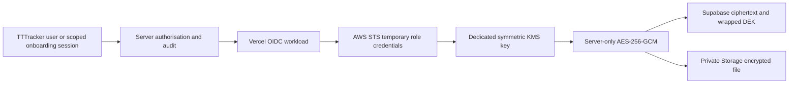

# External KMS boundary for Confidential People data

## Current deployment decision

Collection stays **disabled**. There is no authenticated AWS tooling, linked Vercel project or configured OIDC/KMS identity in this workspace. No AWS resource has been created and no live KMS roundtrip is claimed. Only synthetic fixtures may be used for verification after infrastructure configuration. Production collection cannot be enabled by this implementation's mode switch.

V2 Dev was inspected before the migration: confidential versions, organisation keys and encrypted documents were all zero. No real-value compatibility conversion is needed. Earlier migration history and the legacy Vault boundary guard remain intact; the new Confidential runtime never calls Vault. This document supersedes the Vault architecture in `people-confidential-security.md`.

## Trust chain

KMS generates a fresh 256-bit DEK **per value/document revision**. The DEK exists briefly in server memory and is zeroed where practical. KMS returns a wrapped DEK for persistence. AES-GCM binds the ciphertext to format, organisation, Person/instance, field, record, revision, generation, semantic type, document/value kind, KMS ARN and environment. KMS EncryptionContext additionally binds the wrapped key to the same public identifiers and purpose. No label or submitted answer is used as security policy.

Database key-generation rows contain only provider, KMS ARN, environment and generation number. Version rows additionally contain encrypted DEK, crypto format 2, nonce, tag and ciphertext/object reference. No SQL function receives or returns a plaintext DEK. The old keyless commit interface and Vault key-creation action are blocked. The authorisation-ticket RPC releases context and ciphertext only.

## Infrastructure setup (security operator required)

Use separate development, preview and production customer-managed `SYMMETRIC_DEFAULT` / `ENCRYPT_DECRYPT` keys, and separate federated roles. A separate production AWS account offers stronger isolation. Do not reuse email/storage/general-purpose keys. Start with development only.

1. In Vercel project Security settings, enable Secure Backend Access/OIDC with **Team issuer**. Record the exact team slug, immutable owner ID, project name and immutable project ID. Renames require policy updates.
2. In AWS IAM, register the provider `https://oidc.vercel.com/<team-slug>` and audience `https://vercel.com/<team-slug>`.
3. Create a dedicated environment role, such as `TTTrackerConfidentialCryptoDevelopment`, using `iam-trust-policy.template.json`. Replace placeholders; use exact `StringEquals` audience and subject. Never replace the team/project/environment with wildcards. Trust production only in the production role; preview/development must not assume it.
4. Have the AWS security operator create the dedicated symmetric KMS key with `kms-key-policy.template.json`. The separate key-maintenance principal must be valid and preserve policy-management access. Application runtime has no key-admin/grant/deletion permissions. Do not create a policy that locks out the security operator.
5. Attach `iam-role-policy.template.json` to the crypto role, substituting the **exact key ARN**. Its only actions are `kms:GenerateDataKey`, `kms:Decrypt` and `kms:DescribeKey`. No Encrypt/ReEncrypt/Grant/STS management action is needed. The trust policy permits only `sts:AssumeRoleWithWebIdentity` by the expected Vercel provider.
6. Review both IAM and key policies. Crypto operations require the purpose and environment EncryptionContext, a scoped organisation identifier and an allowed context-key set. In a KMS **key policy**, `Resource: "*"` means the key to which that policy is attached; the IAM role policy names the exact key ARN. It is not account-wide `kms:*` permission.
7. Enable/verify CloudTrail coverage for KMS/STS, with retention/access approved by the security operator. This supplements, not replaces, TTTracker business audit.
8. Set the environment-specific identifiers below in Vercel; redeploy only through the normal authorised workflow. No permanent AWS access key is needed. No resources or deployments are automatically created by this task.

The maintained packages are `@aws-sdk/client-kms`, `@vercel/oidc` and `@vercel/oidc-aws-credentials-provider`. Team issuer and exact claims follow [Vercel AWS federation](https://vercel.com/docs/oidc/aws) and [OIDC reference](https://vercel.com/docs/oidc/reference). The server verifies Vercel's signed token against its JWKS, issuer, audience, subject, owner/project IDs and environment; AWS STS independently verifies its trust policy. STS sessions request 900 seconds. Static/default AWS credential resolution is never used.

## Server configuration

These identifiers are not key material. Keep them server-side and environment-specific; use no actual account IDs/ARNs in generic templates.

| Variable prefix `TTTRACKER_CONFIDENTIAL_` | Value |
| --- | --- |
| `ENVIRONMENT` | `development`, `preview` or `production`; must match Vercel target environment |
| `KMS_REGION` | Fixed AWS key region; do not rely on Vercel's injected AWS_REGION |
| `KMS_KEY_ARN` | Exact customer-managed key ARN; aliases are deliberately rejected |
| `KMS_READ_KEY_ARNS` | Optional comma-separated previously approved key ARNs in the same account/region |
| `AWS_ROLE_ARN` | Exact environment-specific federated role ARN |
| `VERCEL_TEAM_SLUG` | Team issuer slug |
| `VERCEL_PROJECT_NAME` | Exact project name in the subject claim |
| `VERCEL_OWNER_ID` | Expected immutable `team_…` ID |
| `VERCEL_PROJECT_ID` | Expected immutable `prj_…` ID |
| `COLLECTION_MODE` | Defaults to `disabled`; `synthetic` is accepted only outside production |

No `NEXT_PUBLIC_` crypto credentials, permanent AWS credentials, wrapped-key secrets or plaintext keys are added to environment examples. The SDK uses an explicit OIDC credential provider even if unrelated AWS variables exist.

## Local development

Link the correct development Vercel project and use its documented `vercel env pull` mechanism for the short-lived development OIDC token. Preserve/merge existing `.env.local` configuration; do not overwrite it casually. The pulled token is a credential: never commit, print, log, email or paste it into reports. Refresh using the CLI after expiry. Trust only the development environment/key. See [Vercel local OIDC](https://vercel.com/docs/oidc#in-local-development).

Local config is accepted only for development when there is no production runtime identity; signed token verification and AWS trust still apply. Builds do not run crypto at import time. Vercel deployment/build maintainers and the server runtime remain trusted infrastructure.

## Readiness and collection gate

`getConfidentialReadiness()` is server-only; authenticate and authorise its caller before invocation. No public health/decrypt endpoint is added. With collection disabled it does not perform KMS calls. An explicit internal `probe=true` checks infrastructure without enabling collection.

A positive health result requires the expected schema, no unsupported legacy versions, no browser key-release grant, a valid environment-scoped workload identity, enabled symmetric KMS key and a synthetic GenerateDataKey/AES-GCM/Decrypt comparison. Nothing is persisted. Expensive successful self-tests are cached for five minutes; request identity is rechecked even with that cache. Plaintext DEKs are never cached. Failed health results are not cached. Actual KMS failures still fail closed after a cached success.

Mode `synthetic` is an operator-controlled verification gate, not a heuristic that can identify real versus synthetic input. There is no end-user collection UI. Do not send real values to it. Production mode remains disabled regardless of a successful health probe.

## Authorisation, audit and external sessions

Canonical Security Check is unchanged. Internal services first require its authenticated server status, then obtain a JWT-derived ticket through existing People permissions. Active membership, module/entitlement, ownership and explicit-deny precedence are mandatory. Read permission, write permission and key-management permission remain distinct. Platform Admin and ordinary Administrator roles gain no implicit decrypt authority.

SQL ticket redemption rechecks permission/session and records intent before KMS. Writes append ciphertext, wrapped-key metadata and audit atomically under the existing record lock. Successful reads are audited/re-authorised before plaintext is returned; failed reads record a safe failure action. No audit contains answers, plaintext DEKs, tokens or cipher payloads.

External onboarding still exchanges a hash-only one-time token into a narrow expiring session. Its write tickets cover only one organisation/instance/allowlisted field and are revoked with that instance. The recipient cannot call KMS or enumerate People. The server uses the same KMS-backed encryption path after scope validation. No TTTracker membership is created by onboarding.

## Documents and providers

PDF/PNG/JPEG files remain limited to 10 MiB; filename and MIME are encrypted with file bytes. Private Supabase Storage receives ciphertext only. Opaque UUID/write-ticket object paths contain no submitted labels, names or financial values. Reads use an internal 30-second signed URL for **encrypted bytes only**, stream with a strict 10 MiB + 1 KiB envelope bound, then authenticate/decrypt before returning a file. That URL is never returned to the browser; there are no plaintext public links. Invalid/oversize streams fail closed.

AES-GCM must authenticate the complete bounded ciphertext before plaintext is released. This is not an arbitrary-size streaming architecture; increasing the limit requires an explicit memory/authentication design. Signed URL expiry is provided by Storage and requires hosted verification; no plaintext access URL exists to expire.

Logical document/provider metadata remains separate from storage. SharePoint is not connected: encrypted-object storage versus explicit integration release remains a future policy decision. Xero is not connected and receives no blanket read permission.

## Compromise test and its limits

With stolen Supabase service credentials, database ciphertext and encrypted storage objects, an attacker has metadata and wrapped DEKs but no Vercel OIDC/STS/KMS authority. SQL has no KMS network call or root-key retrieval. The wrapped DEK cannot serve as the AES plaintext key. Missing workload identity or STS permission prevents unwrap even when static credential bait exists. Mock/local tests prove that interface boundary; real AWS negative tests are still required.

**Do not claim this defeats every active database compromise.** Full database write authority can corrupt/delete data and tamper with RBAC, audit and auth/session records. A Supabase admin credential can also manipulate auth identities. A future callable decrypted-data endpoint could become an oracle if it trusts authorisation state the attacker can forge. No public decrypt/read endpoint is added here. Before real collection or exposing such endpoints, the security review must address independently trustworthy authorisation/step-up and audit integrity for that threat model. KMS separation alone does not solve compromised application code, Vercel control-plane access or forged business permissions.

KMS EncryptionContext is logged in CloudTrail, so it contains only identifiers, classification/type metadata and environment—never answers, names or emails. AWS errors are mapped to safe access/integrity/unavailable errors without carrying raw response/cause objects. Do not enable SDK request/response body logging or application payload tracing for these modules.

## Rotation and recovery

[KMS CMK rotation](https://docs.aws.amazon.com/kms/latest/developerguide/rotate-keys.html) retains prior key material for decryption; it does not require rewriting every wrapped DEK or ciphertext. TTTracker generation rotation is different: new revisions receive fresh DEKs, and explicit re-encryption writes an audited revision with optimistic concurrency protection. Old generation metadata/history remain retained.

Changing to a different CMK ARN requires an operator-approved old-key read allowlist and matching limited IAM/key policies. It is not an automatic alias switch. Old references must remain usable until historical retention is resolved. No legal retention duration is invented.

Recovery needs coherent Supabase database and encrypted Storage backups plus the correct enabled AWS KMS key and reconstructed exact IAM/OIDC trust. Recreate role/provider names and scopes carefully; a lost role can be replaced, but deleting the CMK permanently destroys recovery of its wrapped DEKs. Normal application/key-maintenance policy templates do not grant ScheduleKeyDeletion. Never schedule deletion as routine cleanup. Use a separately controlled break-glass process and prove no retained backups/history need that key first.

The project has not yet completed an AWS-backed restore drill, AWS policy review, hosted positive/negative federation tests, independent audit custody or a production approval. Database backups now contain only wrapped DEKs/ciphertext, but they are not recoverable without KMS.

## Verification runbook

1. Configure development resources and identity; keep collection disabled.
2. Run an authenticated internal readiness probe in the genuine Vercel request context. Verify it reports cryptoReady but collection disabled.
3. For a controlled test deployment only, enable synthetic mode. Run the hosted fixture runner with no real values/emails; verify value/document roundtrips, tenant binding, permission denies/non-bypasses, tampering, external allowlist/revocation and generation re-encryption.
4. Independently test preview/development tokens against the production role/key and expect denial. Remove OIDC authority from an artifact-only attack runner and expect unwrap failure with database/storage copies.
5. Review CloudTrail against TTTracker metadata-only audits. Execute the exact disposable organisation cleanup; never delete real tenant scopes. Return the deployment to disabled mode.
6. Complete recovery and active-compromise security review before any production collection decision.

No live AWS test is reported merely because package installation or mocked tests pass.
